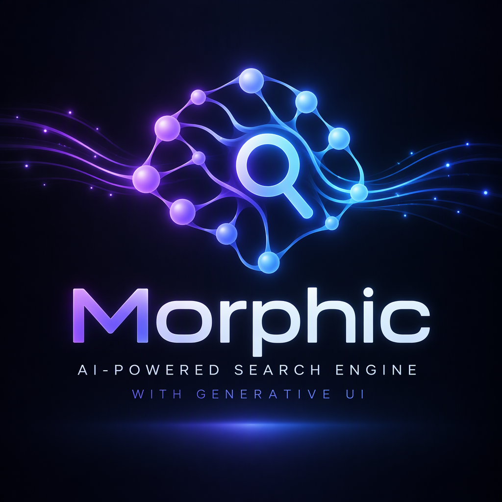
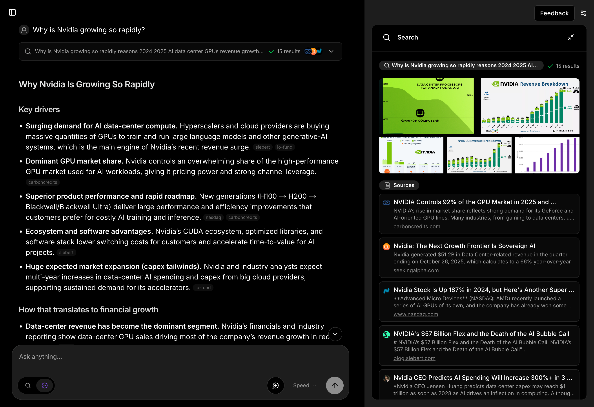

<div align="center">



# Morphic

### AI-Powered Search Engine with Generative UI

[](https://github.com/AARUTO347/morphic-ai-answer-engine-generative-ui/stargazers)
[](LICENSE)
[]()
[]()
[](https://vercel.com/new/clone?repository-url=https%3A%2F%2Fgithub.com%2FAARUTO347%2Fmorphic-ai-answer-engine-generative-ui)

**Forked from [miurla/morphic](https://github.com/miurla/morphic)**

[Features](#-features) • [Screenshots](#-screenshots) • [Quick Start](#-quick-start) • [Docker](#-docker) • [Configuration](#-configuration) • [Deploy](#-deploy)

</div>

---

## About

Morphic is an AI-powered search engine that generates dynamic user interfaces in response to queries. It combines multiple search providers with large language models to deliver rich, interactive answers.

## Screenshots

<div align="center">



</div>

## Features

- **AI-Powered Search** with Generative UI
- **Search Modes:** Quick and Adaptive
- **Model Selector** with dynamic provider detection
  - OpenAI, Anthropic, Google, Ollama, Vercel AI Gateway
- **Multiple Search Providers**
  - Tavily, SearXNG, Brave, Exa
- **Chat History** stored in PostgreSQL
- **Shareable Results** with unique URLs
- **File Upload** support
- **User Authentication** with Supabase Auth
- **Guest Mode** for anonymous usage
- **Docker Deployment** ready

## Quick Start

### Prerequisites

- Node.js 18+
- bun (recommended) or npm/pnpm/yarn
- At least one AI provider API key

### Installation

```bash
git clone https://github.com/AARUTO347/morphic-ai-answer-engine-generative-ui.git
cd morphic-ai-answer-engine-generative-ui
bun install
```

### Environment Setup

```bash
cp .env.local.example .env.local
```

Edit `.env.local` and set your API keys:

```bash
# Required: At least one AI provider
OPENAI_API_KEY=your_openai_key

# Optional: Search providers (SearXNG is included with Docker)
TAVILY_API_KEY=your_tavily_key

# Optional: Features
ENABLE_AUTH=true
```

### Development

```bash
bun dev
```

Visit [http://localhost:3000](http://localhost:3000)

## Docker

The recommended way to run Morphic locally.

### Pull Pre-built Image

```bash
docker pull ghcr.io/miurla/morphic:latest
```

### Build and Run

1. Clone and configure:

```bash
git clone https://github.com/AARUTO347/morphic-ai-answer-engine-generative-ui.git
cd morphic-ai-answer-engine-generative-ui
cp .env.local.example .env.local
# Edit .env.local with at least one AI provider API key
```

2. Start all services:

```bash
docker compose up -d
```

3. Visit [http://localhost:3000](http://localhost:3000)

Docker Compose starts **PostgreSQL**, **Redis**, **SearXNG**, and **Morphic** automatically. No additional search API key is needed — SearXNG is included.

See [Docker Guide](./docs/DOCKER.md) for advanced options.

## Configuration

### Supported AI Providers

| Provider | Environment Variable |
|----------|---------------------|
| OpenAI | `OPENAI_API_KEY` |
| Anthropic | `ANTHROPIC_API_KEY` |
| Google | `GOOGLE_API_KEY` |
| Ollama (local) | `OLLAMA_BASE_URL` |
| Vercel AI Gateway | `AI_GATEWAY_API_KEY` |

### Supported Search Providers

| Provider | Environment Variable |
|----------|---------------------|
| Tavily | `TAVILY_API_KEY` |
| Brave | `BRAVE_API_KEY` |
| Exa | `EXA_API_KEY` |
| SearXNG | Included with Docker |

Full configuration options: [CONFIGURATION.md](./docs/CONFIGURATION.md)

## Deploy

### Vercel (One-Click)

[](https://vercel.com/new/clone?repository-url=https%3A%2F%2Fgithub.com%2FAARUTO347%2Fmorphic-ai-answer-engine-generative-ui&env=OPENAI_API_KEY,TAVILY_API_KEY,ENABLE_AUTH)

### Docker (Self-Hosted)

```bash
docker compose up -d
```

See [Docker Guide](./docs/DOCKER.md) for production deployment.

## Tech Stack

| Layer | Technology |
|-------|-----------|
| Framework | Next.js 15 (App Router) |
| Language | TypeScript |
| AI | Vercel AI SDK |
| UI | shadcn/ui + Tailwind CSS |
| Database | PostgreSQL (Neon Serverless) |
| Cache | Redis |
| Auth | Supabase Auth / Auth.js |
| Storage | Vercel Blob |
| Search | Tavily / SearXNG / Brave / Exa |
| Deployment | Vercel / Docker |

## Documentation

| Document | Description |
|----------|-------------|
| [Configuration](./docs/CONFIGURATION.md) | All environment variables and options |
| [Docker Guide](./docs/DOCKER.md) | Docker deployment and options |
| [Contributing](CONTRIBUTING.md) | How to contribute |

## Contributing

Contributions are welcome! Please see our [Contributing Guide](CONTRIBUTING.md) for details.

## Acknowledgments

- Original project: [miurla/morphic](https://github.com/miurla/morphic)
- [Vercel](https://vercel.com) for Next.js and AI SDK
- [shadcn](https://ui.shadcn.com) for UI components

## License

**Apache License 2.0** — see [LICENSE](LICENSE).

---

<div align="center">

**Morphic** — AI-Powered Search with Generative UI

[GitHub](https://github.com/AARUTO347/morphic-ai-answer-engine-generative-ui) • [Issues](https://github.com/AARUTO347/morphic-ai-answer-engine-generative-ui/issues) • [Original Project](https://github.com/miurla/morphic)

</div>
